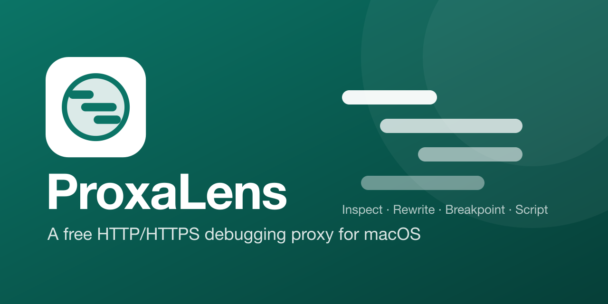

<div align="center">



# 🔍 ProxaLens

**A free, open-source HTTP/HTTPS debugging proxy for macOS.**
See, tweak, mock and replay your app's network traffic — no subscription needed.


</div>

---

## ✨ Why ProxaLens?

Proxyman-style tooling, but free and hackable. A fast Rust engine does the heavy lifting and a React UI makes it pleasant.

## 🚀 Features

### 📡 Capture
- 🔒 **HTTP / HTTPS MITM proxy** on `127.0.0.1:9090`, starting with the app. HTTP/1.1, HTTP/2 and WebSocket supported.
- 📦 Bodies over 5 MB are stored truncated but forwarded whole.
- 📜 **Per-install root CA**, trusted in your login keychain with one click.
- 🛟 **Crash-safe system proxy:** manual or PAC mode, original settings saved first, and a watchdog restores them if the app is killed.

### 🧐 Inspect
- 🗂️ Three-pane inspector: apps & domains → flows → details.
- 🌳 Bodies as JSON tree, text, hex or image; gzip/br/zstd decoded automatically.
- 💬 WebSocket message view, timings, and the app behind each request.
- 🔎 httpmon filter syntax (`m:post s:4xx ct:json re:… app:chrome`) plus method/status chips.

### 🛠️ Debug
- 🔁 Repeat, Edit & Repeat, and Compose.
- 💾 HAR import/export and saved sessions.
- 🐢 Throttling and 📋 Copy as cURL.

### 🎭 Rules
- 🗺️ Map Local, Map Remote, Rewrite and Block rules.
- 🔐 SSL Proxying include/exclude, plus Block and Allow lists.

### 📱 Devices
- Phones and tablets on your network via a setup page with a QR code.
- Certificate install in iOS Simulators.

## 📥 Install

1. Download `ProxaLens_<version>_aarch64.dmg` from the [latest release](https://github.com/naufalzhafran/ProxaLens/releases/latest). Apple Silicon only.
2. Open it and drag **ProxaLens** to **Applications**.
3. The app is unsigned, so macOS will block it the first time. Clear the quarantine flag:

   ```bash
   xattr -dr com.apple.quarantine /Applications/ProxaLens.app
   ```

   Or open it once, then choose **System Settings → Privacy & Security → Open Anyway**.

After that, ProxaLens checks for updates when it starts and offers to install them. You can also check under **Settings → General**.

## 🧑‍💻 Development

**Requirements:** Rust (via `rustup`), Node 20+, Xcode command line tools.

```bash
npm install
npm run tauri dev
```

**Tests**

```bash
npm test
cargo test --manifest-path src-tauri/Cargo.toml
```

**Try the proxy without touching system settings:**

```bash
curl -x http://127.0.0.1:9090 \
  --cacert "$HOME/Library/Application Support/dev.naufalzhafran.proxalens/ca/ca-cert.pem" \
  https://httpbin.org/get
```

**Releasing**

```bash
npm run bump <patch|minor|major|x.y.z>
git commit -am "Release vX.Y.Z" && git tag vX.Y.Z
git push origin main --tags
```

The `Release` workflow tests, builds the `.dmg` and attaches it to a draft GitHub Release. Review the draft and publish it; installed apps see the update once it's published.

Update bundles are signed with the updater key in the `TAURI_SIGNING_PRIVATE_KEY` (and `TAURI_SIGNING_PRIVATE_KEY_PASSWORD`) repo secrets. For a local `npm run tauri build`, export the same variables.

### 🏗️ Project layout

| Path | What lives there |
| --- | --- |
| `src-tauri/src/engine/` | Tauri-independent proxy engine (store, CA, pipeline, rules, HAR…) |
| `src-tauri/src/commands.rs` | IPC surface |
| `src/` | React UI |

## 🤝 Contributing

Issues and pull requests are welcome. Please keep `cargo clippy --all-targets` at zero warnings and never touch the real system proxy or keychain in tests.

## 🙏 Credits

Behaviour and test cases are modelled on [kostyay/httpmon](https://github.com/kostyay/httpmon) (MIT). Built on [Tauri](https://tauri.app), [hudsucker](https://github.com/omjadas/hudsucker) and [React](https://react.dev).

<div align="center">

Made with ❤️ by [@naufalzhafran](https://github.com/naufalzhafran)

</div>
